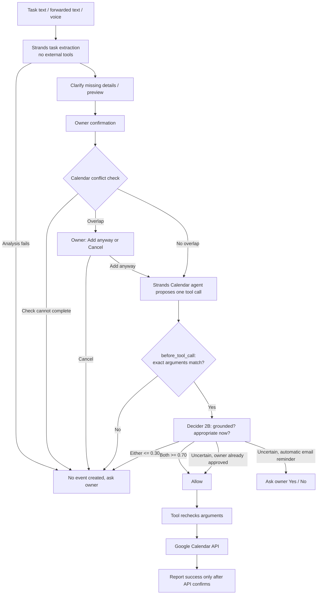

# Maranthudaadha Assistant

> *Maranthudaadha* (மறந்துடாதா) means "the assistant that does not let me forget" in Tamil.

A private Telegram assistant that **pushes** reminders to you instead of waiting for you to open a calendar. It reads Google Calendar, scans important Gmail messages, captures tasks from typed text, forwarded messages and voice notes, saves notes to Notion, and replies in **Tamil, English or Auto (Tanglish-aware)**.

Anything that changes your Calendar or sends your email is controlled: **deterministic checks come first, Strands Decider 2B gives a calibrated second opinion, and you are the final authority for anything uncertain.**

**Tech stack:** Python 3.11 · `python-telegram-bot` · APScheduler · SQLite · Strands Agents · Strands Decider 2B · Google Calendar API · Gmail API · Notion API · optional Gemini voice transcription · Kiro Specs

---

## Contents

- [Why this exists](#why-this-exists)
- [Recent feature highlights](#recent-feature-highlights)
- [Features](#features)
- [How to use the bot](#how-to-use-the-bot)
- [How it stays safe](#how-it-stays-safe)
- [Architecture](#architecture)
- [Project structure](#project-structure)
- [Screenshots](#screenshots)
- [Setup on Windows](#setup-on-windows)
- [Optional integrations](#optional-integrations)
- [Configuration](#configuration)
- [Privacy and data handling](#privacy-and-data-handling)
- [Hosting limitations](#hosting-limitations)
- [Troubleshooting](#troubleshooting)
- [Tests](#tests)
- [Evaluation status and roadmap](#evaluation-status-and-roadmap)
- [Resources](#resources)

---

## Why this exists

Important information arrives in different places: a meeting in Google Calendar, a deadline in Gmail, a task in a forwarded message, an idea in a conversation. A calendar waits for you to open it, so deadlines get missed and follow-ups get forgotten.

Automating this creates a trust problem. An assistant should not guess an unclear date, add the wrong event, double-book your time, or send an email without you knowing what it will do. This project brings everything into one familiar Telegram chat while keeping every important action visible and under your control.

> WhatsApp is not connected. To turn a WhatsApp (or any other app) message into a task, copy or forward its text to the Telegram bot.

## Recent feature highlights

- **Tamil, English, or Auto replies:** choose the language during `/start` or change it later with `/language`. Auto replies in Tamil for Tamil/Tanglish messages and English for English messages, including scheduled updates.
- **Safer Calendar planning:** `/today` separates upcoming and completed events. `/plan` brings together today's focus, completed events, pending tasks, and upcoming email deadlines.
- **Conflict-aware capture and rescheduling:** before creating a captured task or email reminder, the bot checks for overlapping events. `/reschedule` checks the new time for conflicts and moves an event only after confirmation.
- **Gmail at a glance:** `/scanmail` shows Inbox messages from the last five hours, grouped by Seen/Read and Unseen/Unread, with reviewed reply sending and safe fallbacks when AI triage is unavailable.
- **Tasks and reminders:** mark captured tasks or reminder events Done, or snooze reminders for one hour or until tomorrow. The weekly review summarizes completed and pending tasks.
- **Notion notes and voice capture:** save and search notes with Notion, and turn voice notes into tasks when the optional Gemini key is configured.

## Features

| Area | What you get |
|:--|:--|
| **Calendar reminders** | Reminders 1 day, 3 hours and 30 minutes before an event. High-priority events also get 12 hours, 1 hour and 15 minutes, and reminders show a priority label. Every reminder has **Snooze 1h**, **Tomorrow** and **Done** buttons. |
| **Planning** | `/plan` (today's focus, completed events, pending tasks, email deadlines), `/week` (next seven days by date), `/findtime` (free windows, 9 AM-6 PM) |
| **Rescheduling** | `/reschedule` moves an upcoming timed event after a conflict check and your confirmation. Title and duration are preserved and reminders are refreshed. |
| **Task capture** | Send `Tomorrow 5 PM project meeting`, typed or forwarded. The bot extracts title, date, time and priority, asks for anything missing, and previews before adding. |
| **Gmail triage** | Scans important exam, college, GDG, internship, interview and deadline mail every 30 minutes. Cards show sender, received time (IST), Read/Unread status, category and summary. |
| **Gmail replies** | Tap **Reply**, type your reply, review the preview, then tap **Send reply**. A policy review runs before send. Nothing is sent without your explicit action. |
| **Email deadlines** | A clearly quoted, future, unambiguous date can become a High-priority Calendar reminder automatically if Decider confidently approves. Everything else uses a Yes/No prompt. |
| **Voice notes** | Optional Gemini transcription turns voice notes into the same task flow as typed text. |
| **Notion notes** | `/note`, `/searchnotes`, and natural questions such as `GDG meeting la enna sonnanga?` |
| **Briefs** | Morning brief at 7:00 AM and weekly review every Sunday at 8:00 PM, Asia/Kolkata time. |
| **Language** | Tamil, English or Auto, saved per owner. |

**Phases:** Phase 1 Calendar reminders and morning brief. Phase 2 Strands Gmail triage, reply drafting and automatic email reminders. Phase 3 inbox capture and voice notes. Phase 4 Notion notes, snooze and Done buttons, task list and weekly review.

## How to use the bot

Send `/start` once. The first time, the bot asks you to choose Tamil, English, or Auto. You can change this any time with `/language`. Then tap a command from the menu, or just send a normal message.

> **`/tasks` only lists tasks. It does not create one.** To create a task, send its details as a normal message, for example `Tomorrow 5 PM project meeting`.

### Calendar and tasks

| Command | What it does | Example |
|:--|:--|:--|
| `/start` | Opens the bot and shows the command menu | `/start` |
| `/help` | Shows available commands and quick actions | `/help` |
| `/add <event details>` | Starts a Calendar capture, asking for confirmation before adding | `/add Tomorrow 5 PM project meeting` |
| `/today` | Today's events, grouped into Upcoming and Completed | `/today` |
| `/plan` | Today's upcoming and completed events, pending tasks and upcoming deadlines from recent important mail | `/plan` |
| `/week` | Next seven days of events, grouped by date | `/week` |
| `/findtime [minutes]` | Up to five free slots, 9 AM-6 PM, next seven days. Defaults to 30 minutes | `/findtime 45` or `/findtime 1 hour` |
| `/reschedule` | Pick an upcoming timed event, enter a new time, review any overlap, confirm the move | `/reschedule` |
| `/tasks` | Lists captured tasks. Tap **Done** to complete one | `/tasks` |
| `/language` | Choose Tamil, English or Auto | `/language` |
| `/status` | Checks Google Calendar access and shows today's event count | `/status` |
| `/cancel` | Cancels a task waiting for a missing date or time | `/cancel` |

Before adding a captured task or a manually suggested email reminder, the bot checks for overlapping events. On a conflict it shows the existing event and asks whether to **Add anyway** or **Cancel**. If the conflict check itself fails, nothing is added.

### Gmail

| Command | What it does |
|:--|:--|
| `/scanmail` | Scans Inbox mail from the last five hours, grouped by Seen/Read and Unseen/Unread |

On each email card you can check the received time and Read/Unread status, tap **Yes / No** to add or skip a suggested Calendar reminder, or tap **Reply**, type your reply, review the preview and tap **Send reply**. A Telegram quote-reply alone never sends an email.

If the hosted AI service is blocked or unavailable, `/scanmail` still shows the Gmail preview and Seen/Unread status. It only skips AI classification and automatic Calendar suggestions for that message.

### Notion notes

| Command | What it does | Example |
|:--|:--|:--|
| `/note <text>` | Saves a note to Notion. `note pannu <text>` also works | `/note GDG meeting: discussed API authentication` |
| `/searchnotes` | Lists every saved note with content and Notion link | `/searchnotes` |
| `/searchnotes <words>` | Searches saved notes and returns all matches | `/searchnotes GDG API` |
| `/notion` | Checks whether Notion is configured in the running bot | `/notion` |

### Things you can do without a command

| You send | The bot does |
|:--|:--|
| `Tomorrow 5 PM project meeting` | Extracts the task, shows title, date/time and priority, asks you to tap **Yes, add** |
| `direct ah add pannu: Friday 3 PM demo` | Skips the confirmation prompt. The Calendar safety check still applies, and forwarded text cannot use this bypass |
| A voice note | Transcribes it and handles it like a typed task (needs the optional `GEMINI_API_KEY`) |
| `note pannu <text>` | Saves a Notion note, same as `/note` |
| `GDG meeting la enna sonnanga?` | Searches your Notion notes and answers from them |

An unknown command gets a short explanation and points to `/help`.

### Add a task or reminder

1. Send `/add Tomorrow 10 AM project meeting`, or a normal message with the task and its date/time.
2. If the date or time is missing, answer the bot's short follow-up question.
3. Review the proposed title, date/time and priority. Tap **Yes, add** or **No**.
4. The bot schedules reminders and shows **Snooze 1h**, **Tomorrow** and **Done** buttons on each one.

### Automatic messages

| When | What you get |
|:--|:--|
| Before an event | Reminders at 1 day, 3 hours and 30 min. High-priority events get extra reminders |
| 7:00 AM IST daily | Morning brief with today's events |
| Every 30 minutes | Gmail scan of important Inbox mail |
| Sunday 8:00 PM IST | Weekly review: completed tasks, pending tasks and next week's events |

> The bot must stay running (`main.py` open in PowerShell) for scheduled messages and reminders to work.

## How it stays safe

Every action that changes your Calendar or sends your email goes through checks in a fixed priority order:

1. **Deterministic checks (authoritative):** owner identity, exact-argument matching, duplicate prevention, and the Calendar conflict check.
2. **Strands Decider 2B (second opinion):** answers narrow typed yes/no questions with probabilities. It never calls Google Calendar itself.
3. **You (final authority):** anything uncertain, failed or unavailable falls back to your explicit confirmation, or the action is blocked.

Key rules:

- Only your configured Telegram user ID, in a private chat, can use the bot.
- The task-extraction and email-triage agents have **no external tools**, so text inside an email or forwarded message cannot make them write anything. Emails and forwarded text are treated as untrusted input.
- Unclear dates are never guessed. The bot asks.
- A failed task analysis, a failed conflict check, an unavailable Decider, mismatched arguments or a repeated proposal **fail closed**: no event is created.
- Success is reported only after Google confirms the action.
- Gmail replies are sent only after you press **Send reply**.

### Grounded Calendar Tool Call Guardrail

Calendar creation runs as a registered Strands tool. Its `before_tool_call` intervention checks the proposed title, date/time, priority, and (for automatic email reminders) the exact date quote against the prepared event, then asks Strands Decider 2B whether the action is grounded and appropriate.

| Decider result | Outcome |
|:--|:--|
| Both answers at or above **0.70** | Tool allowed |
| Either answer at or below **0.30** | Tool denied |
| In between, event you already approved | Allowed, relying on your approval of that exact event (Strands `Confirm`) |
| In between, automatic email reminder | Denied; falls back to the manual Yes/No prompt |
| Error, invalid answer, mismatched or repeated proposal | Denied (fail closed) |

The Google Calendar function runs only inside the guarded tool body, which re-checks the arguments. For the automatic-email path, Decider receives the event title, date/time, priority and date quote, not the email body or the full source-message identifier.

This is a reusable pattern: keep deterministic checks authoritative, send a narrow typed question to Decider, and let the tool execute only after the registered intervention returns permission. **The 0.70 and 0.30 values are policy cutoffs, not measured accuracy.**

### Gmail reply policy review

Before a reply is sent, Decider reviews the draft with three answers. A clearly flagged draft is not sent. If the review is uncertain or cannot run, you must explicitly choose **Send anyway**. This uses only the configured free-plan key; it never enables billing or switches to a paid provider.

### Decider kit integration

The assistant vendors the reusable `Decider` client and selected patterns from the AWS User Group Madurai Strands Decider hackathon kit, with the original Apache-2.0 license in `third_party/strands-decider-kit/`. The standalone AgentShield demo, AgentCore integrations, local environments and kit secrets are not included. A model-based tool selector is not used because tool selection is already explicit in Telegram command routing and the Calendar agent has a single tool. Per-note hosted memory scoring is not used because it would send more private data and consume extra free quota.

## Architecture

Five layers:

1. **Telegram interface:** commands, messages, forwarded text, voice notes, buttons. A user-ID check restricts the bot to its owner.
2. **Request handlers:** route commands directly and send ordinary text or transcribed voice to the task flow. Replies follow the saved language.
3. **AI components:** Strands Agents extract task details and classify and summarize selected email. A narrow Calendar action agent can propose one registered tool call.
4. **Integrations and guardrails:** Google Calendar, Gmail and Notion clients; conflict check; Decider checks.
5. **State and scheduling:** SQLite (tasks, reminders, email decisions, language, encrypted OAuth state) and APScheduler jobs.



Gmail flow: scan, Strands triage (no tools), email card, optional guarded Calendar reminder, separate reply preview, Decider policy review, explicit **Send reply**.

`main.py` loads configuration and connects the bot handlers, Google clients, Strands agents, Notion client, SQLite store and scheduled jobs. It supports local Telegram polling and an authenticated webhook mode.

## Project structure

```text
Maranthudaadha-Assistant/
├── assistant/
│   ├── config.py             # Environment loading and validation
│   ├── capture.py            # Strands task extraction; optional Gemini voice transcription
│   ├── email_intelligence.py # Strands structured email triage; no tools
│   ├── strands_runtime.py    # Strands model setup (hosted OpenAI-compatible endpoint)
│   ├── strands_calendar.py   # Decider-gated Calendar tool call
│   ├── reply_policy.py       # Decider policy review before Gmail sends
│   ├── decider_limits.py     # Shared hosted Decider request-rate limit
│   ├── gmail.py              # Filtered Gmail read and Telegram summaries
│   ├── google_calendar.py    # Calendar read/create and encrypted OAuth tokens
│   ├── handlers.py           # Telegram commands, inbox capture and confirmations
│   ├── jobs.py               # Calendar, Gmail, reminder, morning-brief jobs
│   ├── notion_notes.py       # Notion note save/search via the public REST API
│   ├── store.py              # SQLite tokens, captures, email decisions, reminders, snoozes
│   ├── web.py                # Authenticated Telegram webhook for Render
│   └── __init__.py
├── decider_kit/              # Reusable Decider client and selected patterns from the kit
├── third_party/
│   └── strands-decider-kit/  # Original Apache-2.0 license and attribution
├── .kiro/specs/maranthudaadha-assistant/
│   ├── requirements.md       # Product requirements and acceptance criteria
│   ├── design.md             # System design and safety boundaries
│   └── tasks.md              # Implementation phases and remaining setup
├── scripts/auth_google.py    # One-time Google OAuth consent flow
├── data/                     # Created at runtime; ignored by Git
├── .env.example
├── main.py
└── requirements.txt
```

The product requirements, design and checklist live in [`.kiro/specs/maranthudaadha-assistant/`](.kiro/specs/maranthudaadha-assistant/). They were written with [Kiro Specs](https://kiro.dev/docs/specs/) to trace each feature from requirement to design to acceptance check.

## Screenshots

OAuth state/code values and Telegram API request URLs are redacted or cropped.

**Google OAuth callback**


**OAuth access-denied callback example**


**Scheduler running**


**Gmail summaries in Telegram**


**Calendar capture and reminders in Telegram**


[](https://gitdiagram.com/selva-meenakshi-k/maranthudaadha-assistant?utm_source=readme&utm_medium=picture)

## Setup on Windows

### Requirements

- Python 3.11
- A Telegram bot token from `@BotFather`
- A Google Cloud OAuth **Desktop app** client with Google Calendar API and Gmail API enabled
- The Strands/Decider API key from your hackathon kit (check its free-plan limits)
- *(Optional)* A Gemini API key for voice-note transcription
- *(Optional)* A Notion internal integration and a database shared with it

Open **PowerShell** in the project folder. If unsure, open the folder in File Explorer, click the address bar, type `powershell`, and press Enter.

### A. Prepare the project and private settings

1. Make a private copy of the sample settings:

   ```powershell
   Copy-Item .env.example .env
   ```

   Keep `.env` private. Never paste its values into chat or GitHub.

2. **Telegram bot:** in Telegram open `@BotFather`, send `/newbot`, follow the prompts, and put the token in `TELEGRAM_BOT_TOKEN`.

3. **Your Telegram ID:** get your numeric ID from a trusted lookup and put it in `TELEGRAM_USER_ID`. The bot accepts commands only from this ID in a private chat.

4. **Google access:**
   - In [Google Cloud Console](https://console.cloud.google.com/), create a project and enable **Google Calendar API** and **Gmail API**.
   - Configure the OAuth consent screen for personal testing and add your Google account as a test user.
   - Under Data Access, request `calendar.readonly`, `calendar.events`, `gmail.readonly` and `gmail.send`. `gmail.send` is used only after you review a reply and press **Send reply**.
   - Create an OAuth client of type **Desktop app**, download its JSON, and copy the complete JSON onto one line in `GOOGLE_CLIENT_CONFIG_JSON`.
   - Google treats `gmail.readonly` as a restricted scope, so you may see an unverified-app warning during personal testing. See [Google's Gmail scope guidance](https://developers.google.com/workspace/gmail/api/auth/scopes).

5. **Hosted Strands service:** put the supplied key in `DECIDER_API_KEY`. Leave `STRANDS_API_KEY` empty unless you have a separate model key (the app reuses `DECIDER_API_KEY`). Leave `DECIDER_URL`, `STRANDS_BASE_URL` and `STRANDS_MODEL` at their defaults unless the kit says otherwise.

### B. Install and connect Google

6. Check Python 3.11:

   ```powershell
   py -3.11 --version
   ```

   If Windows says no suitable runtime was found, install Python 3.11, reopen PowerShell, and check again.

7. Create the environment and install packages (no activation needed):

   ```powershell
   py -3.11 -m venv .venv
   .\.venv\Scripts\python.exe -m pip install -r requirements.txt
   ```

8. Generate the token encryption key and put the output in `TOKEN_ENCRYPTION_KEY`. Keep it safe; losing it means the saved Google token must be created again:

   ```powershell
   .\.venv\Scripts\python.exe -c "from cryptography.fernet import Fernet; print(Fernet.generate_key().decode())"
   ```

9. Connect Google once. A browser opens; sign in, review the access and press **Allow**. The token is encrypted into `data/assistant.sqlite3` on this computer:

   ```powershell
   .\.venv\Scripts\python.exe scripts\auth_google.py
   ```

   If Google was connected before Gmail reply support was added, run this again so consent includes `gmail.send`. Don't delete `data/assistant.sqlite3` unless you intend to reconnect and lose the bot's saved state.

### C. Start the bot

10. Start the bot and keep the window open:

    ```powershell
    .\.venv\Scripts\python.exe main.py
    ```

    To restart, press **Ctrl+C** and run the same command again.

11. Open your bot in Telegram and send `/start`. The first start asks you to choose Tamil, English or Auto, then shows the welcome message and quick-command keyboard. Opening the chat alone does not send `/start`.

## Optional integrations

### Gemini voice transcription

Put a Gemini API key in `GEMINI_API_KEY` for voice-to-text. Without it, text, tasks, Calendar and Gmail still work. The key is used only for voice transcription. See [Gemini audio transcription](https://ai.google.dev/gemini-api/docs/generate-content/transcribe) and [Gemini billing](https://ai.google.dev/gemini-api/docs/billing/).

### Notion notes

1. Create an **internal connection** in Notion's developer settings.
2. Give it **Read content** and **Insert content** access, then share the notes database with that connection.
3. Use a full-page database with a **Name** title property and a **Content** rich-text property.
4. Put the secret in `NOTION_API_TOKEN` and the database's **data source ID** in `NOTION_DATA_SOURCE_ID`. Never paste the token into Telegram, chat, screenshots or GitHub.
5. Restart the bot and send `/notion` to check the connection.

See Notion's [connection setup guide](https://developers.notion.com/guides/get-started/overview) and [data source query reference](https://developers.notion.com/reference/query-a-data-source).

## Configuration

All secrets belong in `.env` locally or in your hosting provider's secret settings. Never put them in chat, screenshots, GitHub or source files.

| Variable | Purpose | Default |
|---|---|---|
| `TELEGRAM_BOT_TOKEN` | Telegram bot token | Required |
| `TELEGRAM_USER_ID` | The one allowed Telegram user | Required |
| `GOOGLE_CLIENT_CONFIG_JSON` | OAuth desktop client JSON | Required |
| `TOKEN_ENCRYPTION_KEY` | Fernet key for the OAuth token at rest | Required |
| `GOOGLE_TOKEN_ENCRYPTED` | Optional encrypted token bootstrap for a fresh host | Empty |
| `DATABASE_PATH` | SQLite database location | `data/assistant.sqlite3` |
| `TIMEZONE` | Calendar and scheduled-message timezone | `Asia/Kolkata` |
| `CALENDAR_ID` | Google Calendar identifier | `primary` |
| `CALENDAR_SYNC_MINUTES` | Upcoming event refresh interval | `5` |
| `CALENDAR_LOOKAHEAD_DAYS` | How far ahead to schedule reminders | `45` |
| `REMINDER_CHECK_SECONDS` | How often to deliver due reminders | `30` |
| `GEMINI_API_KEY` | Optional Gemini key (voice transcription only) | Empty (voice notes paused) |
| `GEMINI_MODEL` | Gemini transcription model | `gemini-3.5-flash` |
| `DECIDER_API_KEY` | Strands Decider hosted API key | Required for the Calendar write guard |
| `DECIDER_URL` | Strands Decider endpoint | Hackathon hosted endpoint |
| `STRANDS_API_KEY` | Optional separate key for the Strands-compatible model | Defaults to `DECIDER_API_KEY` |
| `STRANDS_BASE_URL` | OpenAI-compatible Strands model endpoint | Hackathon hosted endpoint `/v1` |
| `STRANDS_MODEL` | Hosted model used by Strands Agents | `qwen3.5-4b` |
| `GMAIL_SCAN_MINUTES` | Gmail scan interval | `30` |
| `GMAIL_SCAN_MAX_RESULTS` | Max matching messages considered per scan | `30` |
| `VOICE_MAX_MB` | Max Telegram voice file size | `20` |
| `VOICE_MAX_SECONDS` | Max voice note duration | `300` |
| `NOTION_API_TOKEN` | Notion integration secret | Empty (Notion off) |
| `NOTION_DATA_SOURCE_ID` | Shared Notion notes data source ID | Empty (Notion off) |

## Privacy and data handling

- Only the configured Telegram user ID, in a private chat, can use the bot.
- Google OAuth tokens are encrypted in SQLite with `TOKEN_ENCRYPTION_KEY`.
- **Gmail:** attachments are not downloaded. The scan queries the last day through Gmail and applies an exact five-hour cutoff locally. Matching academic/career email content is sent to the configured Strands model for classification, summary and date extraction; other mail uses Gmail's short preview and is not sent to the model. Raw body text is used in memory only. SQLite keeps IDs, subject/sender, a short summary, extracted date/evidence and your decision. Check the provider's data terms and free-plan limits before use. The app never enables billing or upgrades a plan.
- **Tasks:** task text is sent to the hosted Strands model to extract title, date, time and priority. The extraction agent has no external tools and cannot write to Calendar.
- **Voice:** with `GEMINI_API_KEY`, Telegram voice bytes are temporarily uploaded for transcription, and local and remote copies are deleted best-effort. Audio is never stored in SQLite. The transcript goes through the same confirmation flow. Voice is limited to 20 MB and 5 minutes by default.
- **Notion:** note text is sent to Notion and is not copied into SQLite.
- **OAuth testing:** external OAuth apps in Testing status receive refresh tokens that expire after seven days for Gmail scopes, so you may need to reauthorize with `python scripts/auth_google.py` (also needed after adding scopes). See [Google's OAuth refresh-token limits](https://developers.google.com/identity/protocols/oauth2/).

### Behavior details

- Calendar is fetched every few minutes. Reminders are deduplicated in SQLite and rescheduled when event details change. Calendar API work runs off the Telegram event loop, and a failed reminder send stays pending to retry.
- Automatic email reminders require a future, unambiguous full date matching its exact quoted evidence. Relative and ambiguous numeric dates stay on Yes/No. Date-only items become all-day events, explicit times become one-hour events, past dates are rejected, and stable event IDs prevent duplicates.
- A complete capture shows Yes/No. Creation happens only after Yes, except for an explicit, unforwarded `direct ah add pannu`. Failed or rejected captures never create events.
- If date or time is missing, the bot keeps one pending clarification; answer it or use `/cancel` before starting another capture.
- Snooze is refused if it would land at or after the event start.
- Weekly review lists tasks completed in the past seven days, pending captured tasks, and Google Calendar events for the coming Monday-Sunday. Only captured tasks can be marked complete.
- Replies are capped at 3,000 characters and sent in the original Gmail thread.

## Hosting limitations

The app can be deployed as a Render web service, but **Render Free is not reliable for time-based reminders**. Free services sleep after 15 minutes without inbound requests, and local files (including SQLite) are ephemeral. A sleeping instance cannot run the 7 AM job or reminder loop, and its reminder history may disappear. See Render's [Free instance limitations](https://render.com/docs/free).

For dependable reminders, run the process on an always-on computer, or use hosting with an always-on worker and persistent storage. No Render or AWS service is created by this project, and you should not enter payment details unless you decide to later.

**Render preview (demo only):**

1. Run `python scripts/auth_google.py --export-env-token` locally and copy the printed encrypted token into Render's `GOOGLE_TOKEN_ENCRYPTED` secret. Keep `TOKEN_ENCRYPTION_KEY` the same as when it was encrypted.
2. Push the folder to a Git repository and create a Python Web Service with build command `pip install -r requirements.txt` and start command `python main.py`.
3. Set the required environment values, plus `WEBHOOK_BASE_URL` (the public `https://....onrender.com` URL) and `WEBHOOK_SECRET` (a random string of at least 32 characters). The app then uses Telegram webhooks on Render's `PORT` and checks Telegram's secret-token header. Without `WEBHOOK_BASE_URL` it uses polling.

Treat the exported token and encryption key as secrets.

## Troubleshooting

| Problem | Fix |
|:--|:--|
| Bot says Calendar is not connected | Run `python scripts/auth_google.py` again |
| Google access is denied | Confirm Calendar API and Gmail API are enabled and your account is a consent-screen test user, then rerun `auth_google.py` after scope changes |
| Token cannot decrypt | Restore the original `TOKEN_ENCRYPTION_KEY`, or delete the local database and repeat OAuth |
| No reminder arrives | Check that `python main.py` is still running, the event is within the lookahead window, and the system clock/timezone is correct |
| No response from Telegram | Verify the bot token and your numeric Telegram ID in `.env`; send `/start` in a private chat |

## Tests

```powershell
.\.venv\Scripts\python.exe -m unittest discover -s tests -v
```

The tests use temporary SQLite databases and mocked Notion HTTP responses. They do not contact Telegram, Google, Gemini or Notion.

## Evaluation status and roadmap

The Kiro acceptance checks describe expected behavior; they are not benchmark results. **No accuracy, false-accept-rate or latency numbers have been measured yet**, and none are claimed. The 0.70 and 0.30 thresholds are policy settings, not accuracy.

**Planned, not built yet:**

| Area | Planned improvement |
|:--|:--|
| Evaluation | Labeled test set with measured false-accept rate, false-reject rate and latency |
| Visibility | `/audit` command listing allowed, blocked and confirmed actions with reasons; show Decider confidence in confirmations |
| Security | Prompt-injection test cases for emails and forwarded text; rate limiting; token-rotation reminder |
| Availability | Always-on hosting with persistent storage and a health check; verify missed reminders are delivered after the computer sleeps |
| Safety | Put event delete under the same guardrail and extend the Decider check to reschedule |
| Usefulness | Recurring events, travel-time buffers, focus blocks |

Not included: free-form conversational function calling and automatic task-completion detection. Task completion is user-marked.

## Resources

- [Project source code on GitHub](https://github.com/SELVA-MEENAKSHI-K/Maranthudaadha-Assistant)
- [Kiro Specs documentation](https://kiro.dev/docs/specs/)
- [Strands Agents documentation](https://strandsagents.com/docs/)
- [Strands Decider 2B source](https://github.com/strands-labs/strands-decider)
- [AWS User Group Madurai Strands Decider hackathon kit](https://github.com/Vivek0712/decider-hackathon-kit)
- [Google Calendar API overview](https://developers.google.com/workspace/calendar/api/guides/overview)
- [Gmail API overview](https://developers.google.com/workspace/gmail/api/guides)
- [Notion data-source query API](https://developers.notion.com/reference/query-a-data-source)
