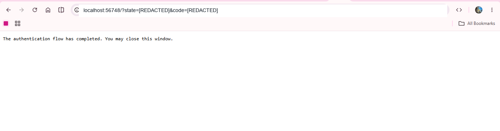
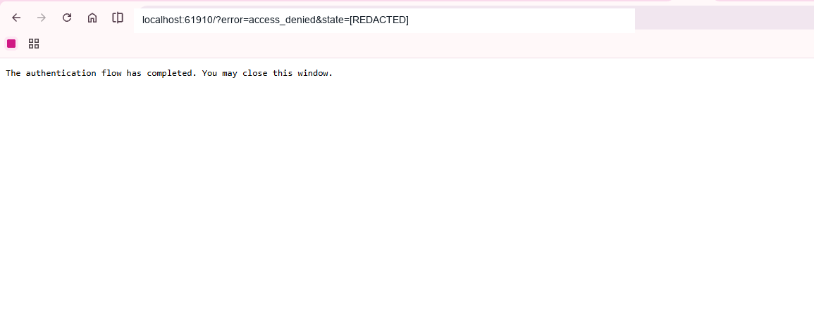
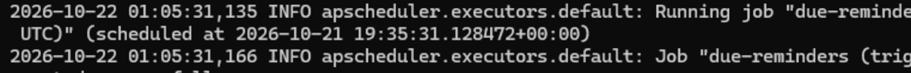
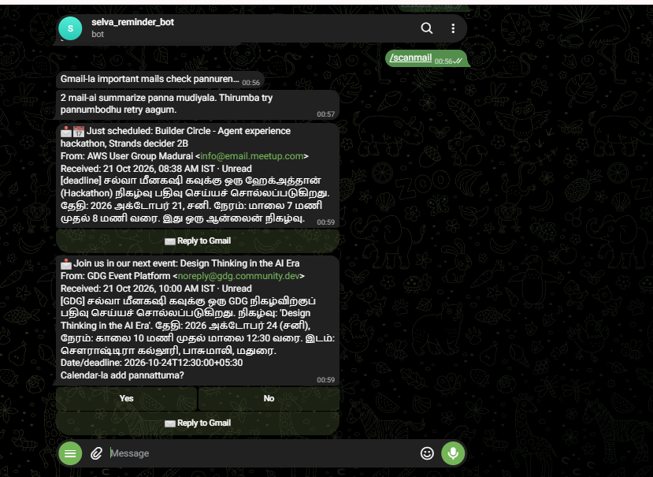
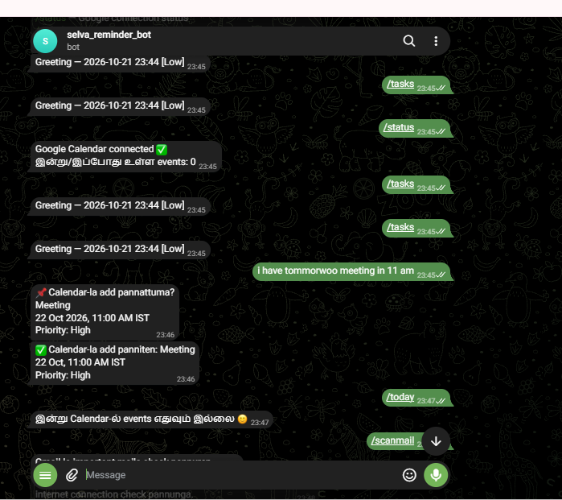

# Maranthudaadha Assistant — Phases 1–4

A private Telegram assistant that reads Google Calendar, sends event reminders, scans selected Gmail messages every 30 minutes, accepts typed/forwarded tasks and voice notes, and sends a calendar/email brief at **7:00 AM Asia/Kolkata**. Text understanding and email triage run through **Strands Agents** on the provided Strands-compatible hosted model. Every Calendar write passes a Strands `before_tool_call` intervention backed by **Strands Decider 2B**. This project does not use Amazon Bedrock or AWS credentials.

Phase 2 adds Strands-based Gmail triage, received date and Gmail Read/Unread status, reply drafting with an explicit Send confirmation and a Decider-backed policy review before send, and automatic Calendar reminders for important emails only when the date is explicitly quoted and Strands Decider confidently approves. Uncertain, rejected, or failed automatic decisions keep the Yes/No Calendar prompt. Phase 3 adds inbox capture and Telegram voice notes: details are extracted into a structured task, missing date/time is clarified, and a complete event requires Yes unless the user explicitly says “direct ah add pannu”. The exact Calendar tool call still passes through Decider before it runs. High-priority events receive additional reminders. Phase 4 adds Notion note save/search, reminder snooze and Done buttons, a task list, and a Sunday 8 PM weekly review.

## Project structure

```text
Maranthudaadha-Assistant/
├── assistant/
│   ├── config.py             # Environment loading and validation
│   ├── capture.py            # Strands task extraction; optional Gemini voice transcription
│   ├── email_intelligence.py # Strands structured email triage; no tools
│   ├── strands_runtime.py    # Strands model setup (hosted OpenAI-compatible endpoint)
│   ├── strands_calendar.py   # Decider-gated Calendar tool call
│   ├── reply_policy.py       # Decider policy review before Gmail sends
│   ├── decider_limits.py     # Shared hosted Decider request-rate limit
│   ├── gmail.py              # Filtered Gmail read and Telegram summaries
│   ├── google_calendar.py    # Calendar read/create and encrypted OAuth tokens
│   ├── handlers.py           # Telegram commands, inbox capture and confirmations
│   ├── jobs.py               # Calendar, Gmail, reminder, morning-brief jobs
│   ├── notion_notes.py       # Notion note save/search via the public REST API
│   ├── store.py              # SQLite tokens, captures, email decisions, reminders and snoozes
│   ├── web.py                # Authenticated Telegram webhook for Render
│   └── __init__.py
├── decider_kit/               # Reusable Decider client and selected patterns from the supplied kit
├── third_party/
│   └── strands-decider-kit/   # Original Apache-2.0 license and attribution
├── .kiro/
│   └── specs/maranthudaadha-assistant/
│       ├── requirements.md    # Product requirements and acceptance criteria
│       ├── design.md          # System design and safety boundaries
│       └── tasks.md           # Implementation phases and remaining setup
├── scripts/
│   └── auth_google.py        # One-time Google OAuth consent flow
├── data/                     # Created at runtime; ignored by Git
├── .env.example
├── main.py
└── requirements.txt
```

## Screenshots

These screenshots show the local Google OAuth callback, the running scheduler, and Telegram Calendar/Gmail interactions. OAuth state/code values and Telegram API request URLs have been redacted or cropped before publishing. Repeated copies of the same Calendar screenshot are included once.

### Google OAuth callback



### OAuth access-denied callback example



### Scheduler running



### Gmail summaries in Telegram



### Calendar capture and reminders in Telegram



## Requirements

- Python 3.11
- A Telegram bot token from Telegram's `@BotFather`
- A Google Cloud OAuth desktop client with Google Calendar API and Gmail API enabled
- The Strands/Decider API key supplied through your hackathon kit. Check its free-plan limits; no AWS billing or Bedrock access is used.
- (Optional) A Gemini API key for Telegram voice-note transcription only.
- (Optional) A Notion internal integration and a database shared with it.

## Strands Decider kit integration

This assistant vendors the reusable `Decider` client and selected patterns from the supplied AWS User Group Madurai Strands Decider hackathon kit. Calendar creation uses the guardrail pattern with exact-argument checks, confidence thresholds, explicit Telegram confirmation, shared request-rate limits, and fail-closed behavior. Gmail reply sending uses the policy pattern to review the draft before the final send; a flagged draft is not sent unless it needs human review and the owner explicitly chooses **Send anyway**. This review uses three Decider answers for each reply draft. It uses the configured free-plan key only; it does not enable billing or switch to a paid provider. If the check cannot run, the owner must explicitly choose **Send anyway** to continue. The standalone AgentShield demo, Bedrock/model-routing modules, AgentCore integrations, local environments, and kit secrets are not part of this assistant. Tool selection is already explicit in Telegram command routing and the Calendar agent has one tool, so a second model-based selector would add delay and consume quota without improving the choice. Notion and SQLite provide the app's note/task persistence; per-note hosted memory scoring would send more private data and use extra free quota. See `third_party/strands-decider-kit/` for the license and attribution.

## Kiro project spec

The product requirements, design, and implementation checklist are in [`.kiro/specs/maranthudaadha-assistant/`](.kiro/specs/maranthudaadha-assistant/).

## Setup on Windows

Follow these steps in order. Open **PowerShell** in the `Maranthudaadha-Assistant` project folder. If you are unsure where PowerShell is, open this folder in File Explorer, click the address bar, type `powershell`, and press Enter.

### A. Prepare the project and private settings

1. Make a private copy of the sample settings file:

   ```powershell
   Copy-Item .env.example .env
   ```

   Open `.env` in your editor. Keep this file private; it contains keys and account credentials. Do not paste its values into chat or GitHub.

2. Create your Telegram bot. In Telegram, open `@BotFather`, send `/newbot`, follow the prompts, and copy the bot token into `TELEGRAM_BOT_TOKEN` in `.env`.

3. Get your numeric Telegram user ID using a trusted ID lookup method and put it in `TELEGRAM_USER_ID`. This bot accepts commands only from this ID in a private chat.

4. Set up Google access:

   - In [Google Cloud Console](https://console.cloud.google.com/), create a project and enable **Google Calendar API** and **Gmail API**.
   - Configure the OAuth consent screen for personal testing and add your Google account as a test user.
   - Under Data Access, request `calendar.readonly`, `calendar.events`, `gmail.readonly`, and `gmail.send`. `gmail.send` is only used after you review a reply and press **Send reply** in Telegram.
   - Create an OAuth client of type **Desktop app** and download its JSON file. Copy the complete JSON onto one line in `GOOGLE_CLIENT_CONFIG_JSON` in `.env`.
   - Google treats `gmail.readonly` as a restricted scope. You may see an unverified-app warning during personal testing. See [Google's Gmail scope guidance](https://developers.google.com/workspace/gmail/api/auth/scopes).

5. Set up the hosted Strands service from your hackathon kit. Put the supplied key in `DECIDER_API_KEY`. Unless you have a separate model key, leave `STRANDS_API_KEY` empty; the app will reuse `DECIDER_API_KEY`. Leave `DECIDER_URL`, `STRANDS_BASE_URL`, and `STRANDS_MODEL` at the provided defaults unless the kit instructions say otherwise. This project uses Strands Agents and Strands Decider; it does **not** use Bedrock or AWS credentials. Review the provider's free-plan limits before use.

### B. Install and connect Google

6. Check Python 3.11 is installed:

   ```powershell
   py -3.11 --version
   ```

   If Windows says no suitable runtime was found, install Python 3.11, close and reopen PowerShell, and run that check again.

7. Create the project environment and install packages:

   ```powershell
   py -3.11 -m venv .venv
   .\.venv\Scripts\python.exe -m pip install -r requirements.txt
   ```

   These instructions use the environment's Python directly, so PowerShell activation is not needed.

8. Generate the local encryption key for the Google token. Run this after installing packages:

   ```powershell
   .\.venv\Scripts\python.exe -c "from cryptography.fernet import Fernet; print(Fernet.generate_key().decode())"
   ```

   Copy the output into `TOKEN_ENCRYPTION_KEY` in `.env`. Keep it safe. Losing it means the saved Google token must be created again.

9. Connect Google once. This opens a browser. Sign into the Google account that owns the Calendar and Gmail, review the requested access, and press **Allow**. The app encrypts the token into `data/assistant.sqlite3` on this computer:

   ```powershell
   .\.venv\Scripts\python.exe scripts\auth_google.py
   ```

   If Google was already connected before adding Gmail reply support, run this again so Google's saved consent also includes `gmail.send`. Don't delete `data/assistant.sqlite3` unless you intentionally want to reconnect and lose the bot's saved state.

### C. Start and use the bot

10. Start the bot and keep this PowerShell window open:

   ```powershell
   .\.venv\Scripts\python.exe main.py
   ```

   To restart later, press **Ctrl+C** in the bot's PowerShell window and run the same start command again.

11. Open your bot in Telegram and send `/start`. The bot shows the command menu. To use it, tap the Telegram command menu or the quick buttons. Opening the chat by itself does not send `/start`; enter `/start` once to see the welcome message and keyboard.

12. Try these actions:

   - Send a task such as `Tomorrow 5 PM project meeting`. Review the date/time and tap **Yes, add**. The Calendar event is created only after Strands Decider permits the tool call.
   - Send `/today` to see today's Calendar events; `/tasks` to see captured tasks; `/status` to check Calendar access; `/scanmail` to scan matching email now.
   - Important email cards show received time and Read/Unread state. Tap **Reply to Gmail**, type the reply, review its preview, then tap **Send reply**. A Telegram quote reply does not send an email.
   - Important emails with clear, quoted dates may get a Calendar reminder automatically only after Decider confidently approves. Unclear dates or uncertain/rejected decisions show Yes/No for manual review.
   - Gmail scans every 30 minutes while the bot is running. Scheduled reminders and daily/weekly briefs also require the process to stay running.

## Optional integrations

### Gemini voice transcription

Voice notes are optional. Put a Gemini API key in `GEMINI_API_KEY` if you want voice-to-text. Without it, text messages, tasks, Calendar, and Gmail still work. The key is used only for voice transcription.

### Notion notes (can be configured later)

1. Create an **internal connection** in Notion's developer settings.
2. Give it **Read content** and **Insert content** access, then share the notes database with that connection. The connection can access only the content you grant it.
3. Use a full-page database with a **Name** title property and a **Content** rich-text property.
4. Put its secret in `NOTION_API_TOKEN` and the database's **data source ID** in `NOTION_DATA_SOURCE_ID` in `.env`. Never paste the token into Telegram, chat, screenshots, or GitHub.
5. Restart the bot and send `/notion` to check the connection. Use `/note <text>` to save and `/searchnotes <words>` to search.

See Notion's [official connection setup guide](https://developers.notion.com/guides/get-started/overview) and [data source query reference](https://developers.notion.com/reference/query-a-data-source).

## GitHub repository

This project is published at [SELVA-MEENAKSHI-K/Maranthudaadha-Assistant](https://github.com/SELVA-MEENAKSHI-K/Maranthudaadha-Assistant). To get a fresh copy, run:

```powershell
git clone https://github.com/SELVA-MEENAKSHI-K/Maranthudaadha-Assistant.git
cd Maranthudaadha-Assistant
```

Then follow the Windows setup steps above. The repository contains the application code, tests, requirements, and this guide. Secrets and local runtime data are excluded.

If you are publishing a **new copy/fork** of this project:

1. Create an **empty** GitHub repository. Do not ask GitHub to add a README, `.gitignore`, or licence because those files are already here.
2. In PowerShell, go to that project folder. Initialize Git and stage the project:

   ```powershell
   git init -b main
   git add .
   git status --short
   ```

3. Review the file list. It should include source, tests, `README.md`, `requirements.txt`, `.gitignore`, and `.env.example`. It must not include `.env`, `.venv/`, `data/`, OAuth JSON, or any API key. The checked-in `.gitignore` excludes these private files.
4. Save the local snapshot and connect the empty GitHub repository (replace the URL with the URL shown by GitHub):

   ```powershell
   git commit -m "Initial Maranthudaadha Assistant"
   git remote add origin https://github.com/YOUR-USERNAME/YOUR-REPOSITORY.git
   git push -u origin main
   ```

   GitHub may ask you to sign in. Never put a password or token in the remote URL. If a secret is accidentally published, revoke/rotate it immediately.


## Configuration

All secrets belong in `.env` locally or the hosting provider's secret environment variables. Never paste them into chat, screenshots, GitHub, or source files.

| Variable | Purpose | Default |
|---|---|---|
| `TELEGRAM_BOT_TOKEN` | Telegram bot token | Required |
| `TELEGRAM_USER_ID` | The one allowed Telegram user | Required |
| `GOOGLE_CLIENT_CONFIG_JSON` | OAuth desktop client JSON | Required |
| `TOKEN_ENCRYPTION_KEY` | Fernet key for OAuth token at rest | Required |
| `GOOGLE_TOKEN_ENCRYPTED` | Optional encrypted token bootstrap for a fresh host | Empty |
| `DATABASE_PATH` | SQLite database location | `data/assistant.sqlite3` |
| `TIMEZONE` | Calendar and scheduled-message timezone | `Asia/Kolkata` |
| `CALENDAR_ID` | Google Calendar identifier | `primary` |
| `CALENDAR_SYNC_MINUTES` | Upcoming event refresh interval | `5` |
| `CALENDAR_LOOKAHEAD_DAYS` | How far ahead to schedule reminders | `45` |
| `REMINDER_CHECK_SECONDS` | How often to deliver due reminders | `30` |
| `GEMINI_API_KEY` | Optional Gemini key for voice transcription only | Empty (voice notes paused) |
| `GEMINI_MODEL` | Optional Gemini transcription model | `gemini-3.5-flash` |
| `DECIDER_API_KEY` | Provided Strands Decider hosted API key | Required for Calendar write guard |
| `DECIDER_URL` | Strands Decider endpoint | Hackathon hosted endpoint |
| `STRANDS_API_KEY` | Optional separate key for the hosted Strands-compatible model | Defaults to `DECIDER_API_KEY` |
| `STRANDS_BASE_URL` | OpenAI-compatible Strands model endpoint | Hackathon hosted endpoint `/v1` |
| `STRANDS_MODEL` | Hosted model used by Strands Agents | `qwen3.5-4b` |
| `GMAIL_SCAN_MINUTES` | Gmail scan interval | `30` |
| `GMAIL_SCAN_MAX_RESULTS` | Maximum matching messages considered per scan | `30` |
| `VOICE_MAX_MB` | Maximum Telegram voice file size accepted | `20` |
| `VOICE_MAX_SECONDS` | Maximum voice note duration accepted | `300` |
| `NOTION_API_TOKEN` | Notion integration secret | Empty (Notion features off) |
| `NOTION_DATA_SOURCE_ID` | Shared Notion notes data source ID | Empty (Notion features off) |

## What the current version does

- `/start`, `/today`, and `/status` are handled only in a private chat by the configured Telegram user ID.
- Calendar is fetched every few minutes; event reminders are deduplicated in SQLite and rescheduled when upcoming event details change.
- Calendar API work runs off the Telegram event loop. A failed reminder send remains pending to retry on a later check.
- At 07:00 IST, the bot lists today's Calendar events.
- Google OAuth tokens are encrypted in SQLite using `TOKEN_ENCRYPTION_KEY`.
- Gmail search is limited to Inbox mail from the last two days matching exam, college, GDG, internship, interview, deadline, due date, assignment, placement, or registration keywords. Attachments are not downloaded.
- Matching email content is sent to the configured Strands model for classification, summary, and date extraction. The model has no external tools. Raw body text is used in memory and not saved; SQLite keeps IDs, subject/sender, short summary, extracted date/evidence, and your decision.
- Important mail summaries include the received date in IST and the Read/Unread status Gmail reported at scan time. Press **Reply**, type the exact reply, review the preview, then press **Send reply**; no message is sent before that explicit action. Replies are capped at 3,000 characters and sent in the original Gmail thread.
- An important email with a future, unambiguous full date matching its exact quoted date evidence may create a High-priority Calendar event automatically only if Strands Decider confidently approves it. Relative dates and ambiguous numeric dates stay on the Yes/No confirmation path. The system schedules the normal reminders for an approved event. If the date is unclear, Decider is uncertain/rejects, or a service fails, no automatic event is created. Date-only items become all-day events; explicit times become one-hour events. Past dates are rejected and stable event IDs prevent duplicates.
- If Strands or Decider is unavailable, AI capture/triage or Calendar writes fail safely; a rejected or uncertain write never reaches Google Calendar. Calendar read/reminder features continue.
- Text and forwarded-message capture extracts a task, future date/time, and High/Medium/Low priority. If date or time is missing, the bot asks for it and keeps one pending clarification; answer it or use `/cancel` before starting another capture.
- A complete capture shows Yes/No. Calendar creation happens only after Yes, except for an explicit unforwarded “direct ah add pannu” instruction. Forwarded text cannot grant that bypass. Failed or rejected captures do not create events.
- Voice messages are limited to 20 MB and 5 minutes by default. With optional `GEMINI_API_KEY`, their Telegram voice bytes are temporarily uploaded for transcription and local/remote copies are deleted best-effort. The transcript goes through the same Strands and confirmation flow; audio is not stored in SQLite.
- Calendar events created from captures retain priority in private event metadata. High priority events get reminders at 1 day, 12 hours, 3 hours, 1 hour, 30 minutes, and 15 minutes; Medium/Low keep the 1 day, 3 hours, and 30 minutes schedule. Reminder text displays the priority label.
- `/note <text>` or “note pannu <text>” saves a note in Notion. `/searchnotes <words>` or a question ending “enna sonnanga?” searches the shared data source and returns matching note excerpts with Notion links. Notion note text is sent to Notion and is not copied into SQLite.
- `/tasks` lists captured tasks. Mark a task Done from its button or from a reminder. Reminders include **Snooze 1h**, **Tomorrow**, and **Done**; snooze is refused if it would happen at or after the event start.
- At 20:00 every Sunday (Asia/Kolkata), weekly review lists tasks marked complete during the past seven days, pending captured tasks, and Google Calendar events for the coming Monday–Sunday. Only captured tasks can be marked complete in this version.

## Grounded Calendar Tool Call Guardrail

Calendar creation runs as a registered Strands tool. Its `before_tool_call` intervention checks the proposed title, date/time, priority, and (for automatic email reminders) exact date quote against the prepared event, then asks Strands Decider 2B whether the action is grounded and appropriate. Both answers at or above 0.70 allow the tool; either answer at or below 0.30 denies it; an uncertain answer uses Strands `Confirm` only when the user already approved that exact event. An uncertain automatic email action is denied and falls back to manual Yes/No. Decider errors, mismatched arguments, repeated proposals, and invalid decisions fail closed. The Google Calendar function is called only inside the guarded tool body. The Decider receives the event title, date/time, priority, and date quote for the automatic-email path, not the email body or full source-message identifier.

This is a reusable **Grounded Calendar Tool Call Guardrail** pattern: keep deterministic checks authoritative, send a narrow typed question to Decider, and let the tool execute only after the registered Strands intervention returns permission. Thresholds are initial policy settings, not measured accuracy claims.

## Render free tier limitation

The app can be deployed as a Render web service, but **Render Free is not reliable for time-based reminders**. Free web services sleep after 15 minutes without inbound requests, and local files (including SQLite) are ephemeral and may be lost on sleep, restart, or deploy. That means a sleeping instance cannot run the 7 AM job or reminder loop, and its reminder history may disappear. See Render's [Free instance limitations](https://render.com/docs/free).

For dependable daily reminders, keep the process running on an always-on computer or choose hosting with an always-on worker and persistent storage. No Render/AWS service is created by this project. Do not enter payment details or choose a paid plan unless you decide to later.

For a Render preview, first run local Google OAuth with `python scripts/auth_google.py --export-env-token`. Copy the printed encrypted token into Render's `GOOGLE_TOKEN_ENCRYPTED` secret setting. Keep `TOKEN_ENCRYPTION_KEY` the same as the key used when encrypting it. Push this folder to a Git repository, create a Python Web Service with build command `pip install -r requirements.txt` and start command `python main.py`. Set the required environment values in Render and additionally set `WEBHOOK_BASE_URL` to the service's public `https://....onrender.com` URL and `WEBHOOK_SECRET` to a random secret string (at least 32 characters). The app then uses Telegram webhooks and listens on Render's `PORT`; without `WEBHOOK_BASE_URL`, it uses polling for local development. The webhook route checks Telegram's secret-token header. Treat both the exported token and encryption key as secrets; don't publish them.

Even with webhooks, Render Free cannot promise reminder delivery: the sleeping process won't run scheduled jobs until it wakes, and SQLite state can be lost. Use it only as a demo. For dependable use, run locally on a computer that stays on or choose an always-on host and persistent database storage. No cloud account is created by this project.

## Troubleshooting

- **Bot says Calendar is not connected:** run `python scripts/auth_google.py` again.
- **Google access is denied:** confirm Calendar API and Gmail API are enabled, your account is a consent-screen test user, and repeat `python scripts/auth_google.py` after scope changes.
- **Token cannot decrypt:** restore the original `TOKEN_ENCRYPTION_KEY`, or delete the local database and repeat OAuth.
- **No reminder arrives:** check that `python main.py` is still running, the event is within the configured lookahead window, and the system clock/timezone is correct.
- **No response from Telegram:** verify the bot token and your numeric Telegram ID in `.env`; send `/start` in a private chat.

## Tests

After installing the requirements, run the offline unit tests with:

```powershell
   .\.venv\Scripts\python.exe -m unittest discover -s tests -v
```

The tests use temporary SQLite databases and mock Notion HTTP responses; they do not contact Telegram, Google, Gemini, or Notion.

## Phase 2 privacy and OAuth notes

Email content can be sensitive. The app sends only messages matching its Gmail query to the configured hosted Strands model. Check the provider's data terms and free-plan limits before use. The app never enables billing or upgrades a plan automatically.

After adding scopes, reauthorize with `python scripts/auth_google.py`. Google documents that external OAuth apps in Testing status receive refresh tokens that expire after seven days for Gmail scopes; repeated reauthorization may be needed while testing. See [Google OAuth refresh-token limits](https://developers.google.com/identity/protocols/oauth2/).

## Phase 3 privacy and voice notes

Task text is sent to the configured hosted Strands model to extract title/date/time/priority; the extraction agent has no external tools and cannot write to Calendar. Voice transcription optionally uses Gemini 3.5 Transcribe and requires `GEMINI_API_KEY`; without it, typed messages still work. See [Gemini audio transcription documentation](https://ai.google.dev/gemini-api/docs/generate-content/transcribe) and [Gemini billing](https://ai.google.dev/gemini-api/docs/billing/).

## Later phases

Free-form conversational function calling and automatic task completion detection are not included. Task completion is user-marked.
